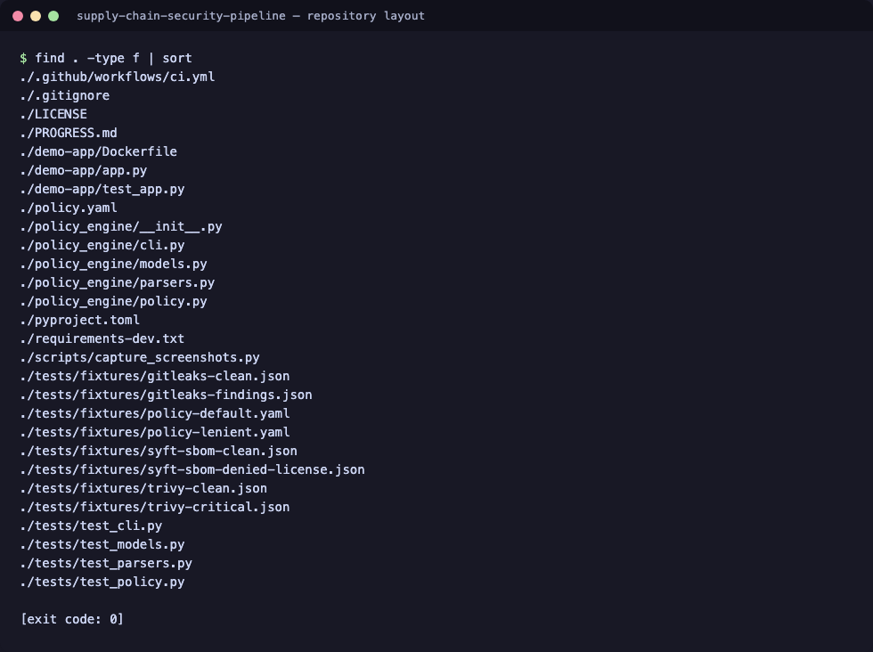
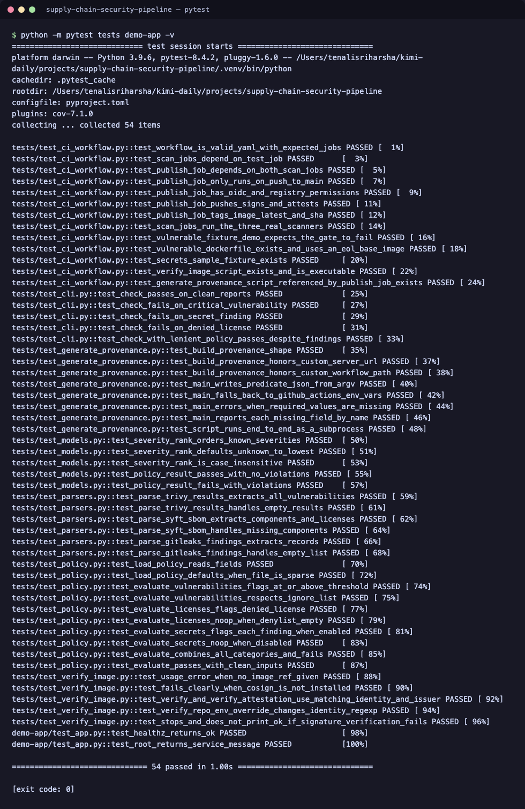
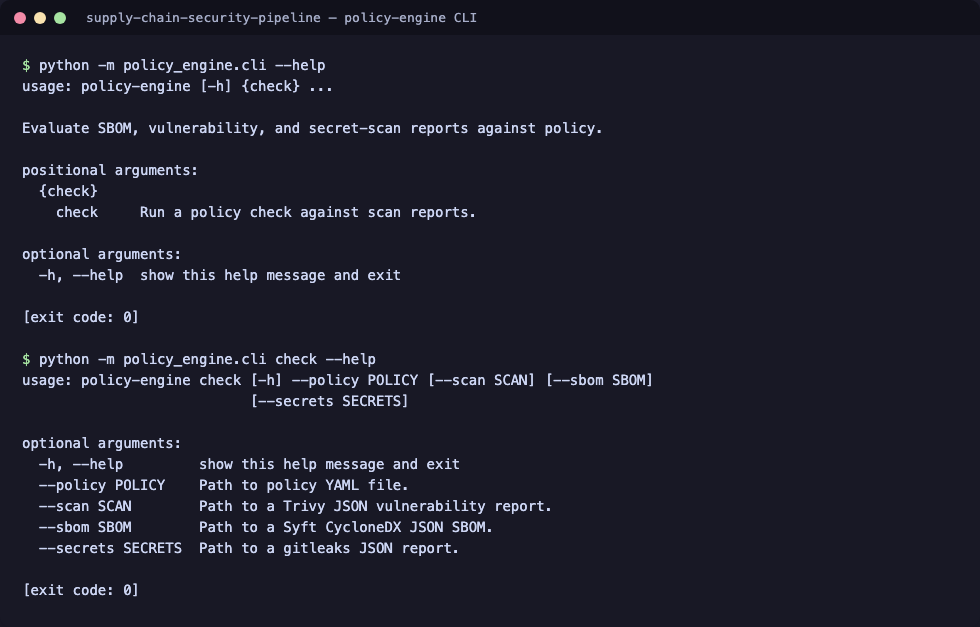
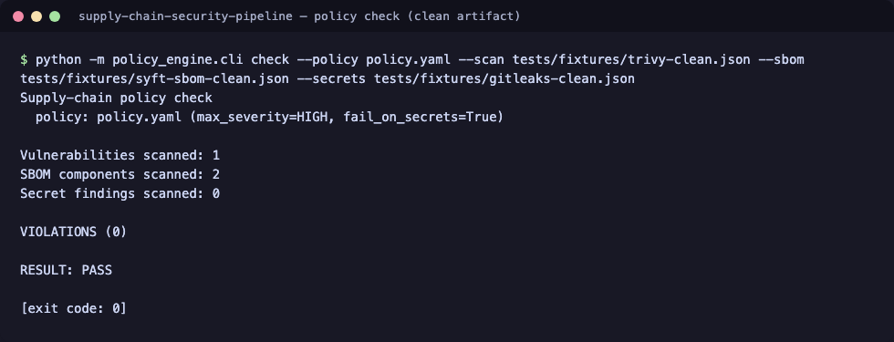
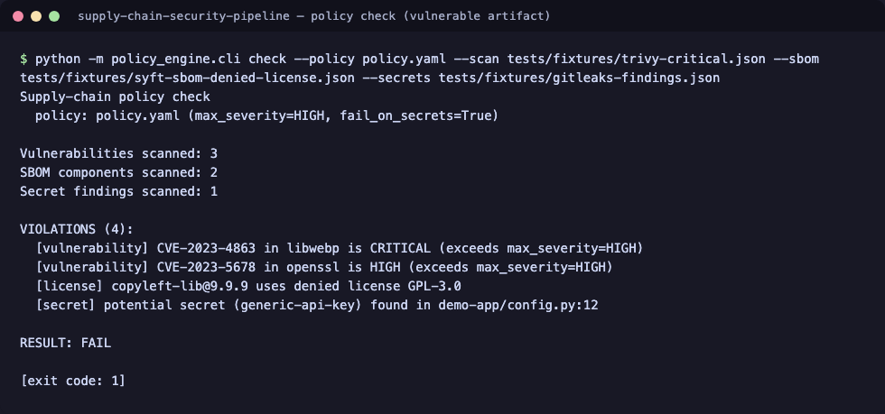
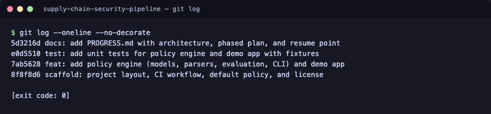

# supply-chain-security-pipeline

[](https://github.com/tenalisriharsha/supply-chain-security-pipeline/actions/workflows/ci.yml) [](LICENSE)

A GitHub Actions pipeline that builds a container image, generates a
Software Bill of Materials (SBOM) with [Syft](https://github.com/anchore/syft),
scans it for known CVEs with [Trivy](https://github.com/aquasecurity/trivy)
and for leaked secrets with [gitleaks](https://github.com/gitleaks/gitleaks),
signs the resulting image with [cosign](https://github.com/sigstore/cosign),
and attaches [SLSA](https://slsa.dev/) provenance so consumers can verify
where and how an image was built. A policy violation — a vulnerability above
the configured severity, a denied license, or a detected secret — fails the
build instead of shipping silently.

> **Project status:** Phase 3 of 4 complete. See [PROGRESS.md](PROGRESS.md)
> for the architecture, the full phased build plan, and exactly where work
> resumes next.

## Preview

The pipeline's policy engine is the piece under active development right
now. These are real, unedited runs of its test suite and CLI against this
repository.

**Repository layout**


**Test suite**


**CLI help**


**Policy check against a clean artifact**


**Policy check against a vulnerable artifact**


**Commit history**


## Quick start

```bash
git clone https://github.com/tenalisriharsha/supply-chain-security-pipeline.git
cd supply-chain-security-pipeline

python3 -m venv .venv && source .venv/bin/activate
pip install -e . -r requirements-dev.txt

# Run the test suite
python -m pytest tests demo-app -v

# Check a clean artifact against the default policy
python -m policy_engine.cli check \
  --policy policy.yaml \
  --scan tests/fixtures/trivy-clean.json \
  --sbom tests/fixtures/syft-sbom-clean.json \
  --secrets tests/fixtures/gitleaks-clean.json
```

## How it works

```
push/PR -> build image -> Syft SBOM -> Trivy scan -----v
                       \-> gitleaks scan -------------> policy engine gate -> cosign sign -> SLSA provenance
```

The **policy engine** (`policy_engine/`) is the core of the pipeline. It
parses Trivy, Syft, and gitleaks JSON reports into a common model and
evaluates them against a declarative `policy.yaml`, independently of any
specific CI provider. The GitHub Actions workflow in
`.github/workflows/ci.yml` runs the real `syft`, `trivy`, and `gitleaks`
CLIs against the built image and feeds their actual JSON output into the
gate — it isn't limited to the recorded fixtures under `tests/fixtures/`.
A second job, `vulnerable-fixture-demo`, builds an intentionally outdated
image (`demo-app/Dockerfile.vulnerable`) and scans a fixture containing a
known-example AWS key (`tests/fixtures/secrets-sample/`) to prove, with
the same real tools, that the gate fails the build when it should. Full
architecture diagram and rationale are in [PROGRESS.md](PROGRESS.md).

On a push to `main` (never on a pull request, which has no registry
credentials and may come from a fork), a third job, `publish`, runs only
after both scan jobs pass. It pushes the demo-app image to GHCR, signs it
keylessly with `cosign` using the job's own GitHub Actions OIDC token, and
attaches a SLSA v0.2 provenance attestation describing exactly which
workflow run, commit, and ref produced it.

## Signing & provenance

The `publish` job in `.github/workflows/ci.yml` publishes
`ghcr.io/<owner>/demo-app` on every push to `main`:

1. Builds and pushes the image, tagged both `:latest` and `:<commit-sha>`.
2. Signs it keylessly with `cosign sign` — no signing key is stored
   anywhere; the signature is backed by the ambient GitHub Actions OIDC
   token and recorded on the public Sigstore transparency log.
3. Generates a SLSA v0.2 provenance predicate with
   `scripts/generate_provenance.py` (pure Python, no network access —
   it just assembles the predicate from the GitHub Actions run context)
   and attaches it with `cosign attest --type slsaprovenance`.

Consumers can check both the signature and the provenance of a published
image with:

```bash
scripts/verify_image.sh ghcr.io/tenalisriharsha/demo-app:latest
```

This requires [cosign](https://docs.sigstore.dev/system_config/installation/)
locally. It verifies that the image was signed by this repository's `ci.yml`
workflow running on `main` (via cosign's keyless certificate identity/issuer
checks) and that it carries a matching SLSA provenance attestation.

## Policy configuration

`policy.yaml` at the repository root controls what fails the build:

```yaml
max_severity: HIGH       # fail on vulnerabilities at or above this severity
fail_on_secrets: true    # fail if gitleaks finds anything
denied_licenses:         # fail if any SBOM component uses one of these
  - GPL-3.0
  - AGPL-3.0
ignore_cves: []          # known false positives / accepted risk, by CVE ID
```

## Repository layout

```
policy_engine/   core policy evaluation library + CLI
demo-app/        minimal HTTP service used as the sample build artifact,
                 plus a deliberately outdated variant for the CI demo job
scripts/         provenance generation and image-verification helpers
tests/           unit tests, CI workflow checks, and scanner-output fixtures
.github/         CI workflow (test, scan, and publish/sign/attest jobs)
```

## Development

```bash
python -m pytest tests demo-app -v
```

## Status

Phase 1 (project scaffold and the policy engine core), Phase 2 (real
`syft`/`trivy`/`gitleaks` integration in CI, with a deliberately vulnerable
fixture that proves the gate fails the build), and Phase 3 (publishing,
keyless cosign signing, and SLSA provenance for the built image) are
complete and tested. The full phase-by-phase build plan, architecture, and
the exact resume point for the next phase live in [PROGRESS.md](PROGRESS.md).

## License

MIT — see [LICENSE](LICENSE).
