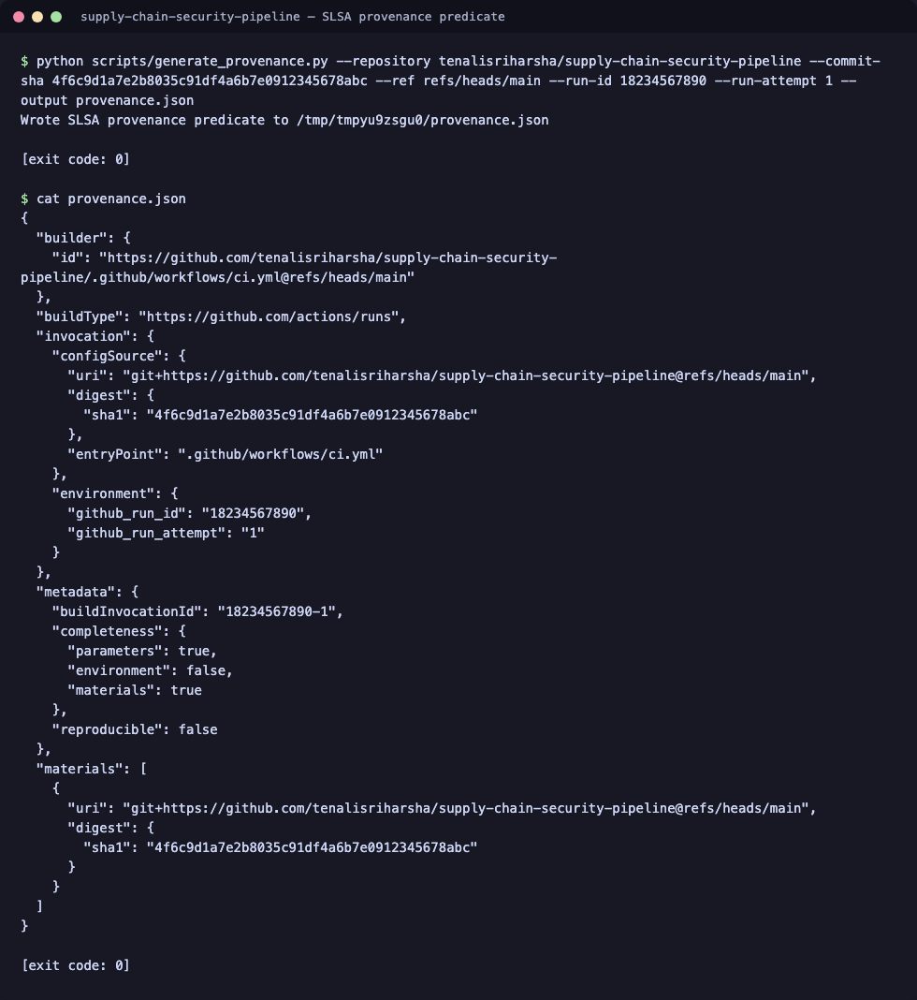
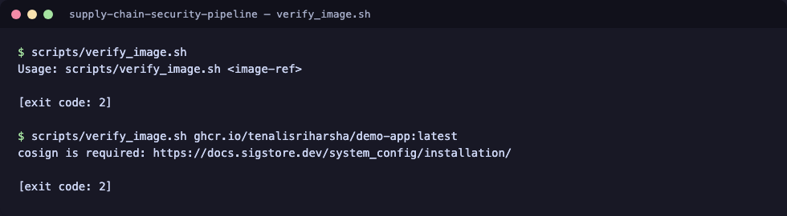

# supply-chain-security-pipeline

[](https://github.com/tenalisriharsha/supply-chain-security-pipeline/actions/workflows/ci.yml) [](LICENSE)

A GitHub Actions pipeline that builds a container image, generates a
Software Bill of Materials (SBOM) with [Syft](https://github.com/anchore/syft),
scans it for known CVEs with [Trivy](https://github.com/aquasecurity/trivy)
and for leaked secrets with [gitleaks](https://github.com/gitleaks/gitleaks),
signs the resulting image with [cosign](https://github.com/sigstore/cosign),
and attaches [SLSA](https://slsa.dev/) provenance so consumers can verify
where and how an image was built. A policy violation — a vulnerability above
the configured severity, a denied license, or a detected secret — fails the
build instead of shipping silently.

## Preview

These are real, unedited runs of the test suite, the CLI, and the
signing/provenance tooling against this repository.

**Repository layout**


**Test suite**


**CLI help**


**Policy check against a clean artifact**


**Policy check against a vulnerable artifact**


**Commit history**


**SLSA provenance generation**


**Image verification script**


## Quick start

Requires Python >= 3.9 and pip >= 21.3 (for [PEP 660](https://peps.python.org/pep-0660/)
editable installs of this `pyproject.toml`-only project — some OS-bundled
`python3`/pip, e.g. macOS's `/usr/bin/python3`, are older than this). Check
with `python3 -m pip --version`; if it's older, upgrade pip inside the venv
as shown below, or use a newer `python3` (e.g. `python3.11 -m venv .venv`).

```bash
git clone https://github.com/tenalisriharsha/supply-chain-security-pipeline.git
cd supply-chain-security-pipeline

python3 -m venv .venv && source .venv/bin/activate
pip install --upgrade pip
pip install -e . -r requirements-dev.txt

# Run the test suite
python -m pytest tests demo-app -v

# Check a clean artifact against the default policy
python -m policy_engine.cli check \
  --policy policy.yaml \
  --scan tests/fixtures/trivy-clean.json \
  --sbom tests/fixtures/syft-sbom-clean.json \
  --secrets tests/fixtures/gitleaks-clean.json
```

## How it works

```
push/PR -> build image -> Syft SBOM -> Trivy scan -----v
                       \-> gitleaks scan -------------> policy engine gate -> cosign sign -> SLSA provenance
```

The **policy engine** (`policy_engine/`) is the core of the pipeline. It
parses Trivy, Syft, and gitleaks JSON reports into a common model and
evaluates them against a declarative `policy.yaml`, independently of any
specific CI provider. The GitHub Actions workflow in
`.github/workflows/ci.yml` runs the real `syft`, `trivy`, and `gitleaks`
CLIs against the built image and feeds their actual JSON output into the
gate — it isn't limited to the recorded fixtures under `tests/fixtures/`.
A second job, `vulnerable-fixture-demo`, builds an intentionally outdated
image (`demo-app/Dockerfile.vulnerable`) and scans a fixture containing a
known-example AWS key (`tests/fixtures/secrets-sample/`) to prove, with
the same real tools, that the gate fails the build when it should. Full
architecture diagram and rationale are in [PROGRESS.md](PROGRESS.md).

On a push to `main` (never on a pull request, which has no registry
credentials and may come from a fork), a third job, `publish`, runs only
after both scan jobs pass. It pushes the demo-app image to GHCR, signs it
keylessly with `cosign` using the job's own GitHub Actions OIDC token, and
attaches a SLSA v0.2 provenance attestation describing exactly which
workflow run, commit, and ref produced it.

## Signing & provenance

The `publish` job in `.github/workflows/ci.yml` publishes
`ghcr.io/<owner>/demo-app` on every push to `main`:

1. Builds and pushes the image, tagged both `:latest` and `:<commit-sha>`.
2. Signs it keylessly with `cosign sign` — no signing key is stored
   anywhere; the signature is backed by the ambient GitHub Actions OIDC
   token and recorded on the public Sigstore transparency log.
3. Generates a SLSA v0.2 provenance predicate with
   `scripts/generate_provenance.py` (pure Python, no network access —
   it just assembles the predicate from the GitHub Actions run context)
   and attaches it with `cosign attest --type slsaprovenance`.

Consumers can check both the signature and the provenance of a published
image with:

```bash
scripts/verify_image.sh ghcr.io/tenalisriharsha/demo-app:latest
```

This requires [cosign](https://docs.sigstore.dev/system_config/installation/)
locally. It verifies that the image was signed by this repository's `ci.yml`
workflow running on `main` (via cosign's keyless certificate identity/issuer
checks) and that it carries a matching SLSA provenance attestation.

## Policy configuration

`policy.yaml` at the repository root controls what fails the build:

```yaml
max_severity: HIGH       # fail on vulnerabilities at or above this severity
fail_on_secrets: true    # fail if gitleaks finds anything
denied_licenses:         # fail if any SBOM component uses one of these
  - GPL-3.0
  - AGPL-3.0
ignore_cves: []          # known false positives / accepted risk, by CVE ID
```

Point `--policy` at any file with this shape — `policy-engine check` takes
the path as an argument, so CI jobs, local runs, and other repositories can
each use their own policy without touching the code.

### What causes a failure, and how to respond

| Violation | Cause | How to resolve |
|---|---|---|
| `[vulnerability] CVE-... is <SEV> (exceeds max_severity=...)` | Trivy found a package at or above the configured severity | Upgrade the affected package; if there's genuinely no fix and the risk is accepted, add the CVE ID to `ignore_cves` with a comment explaining why |
| `[license] <component> uses denied license <LICENSE>` | Syft's SBOM lists a component under a license in `denied_licenses` | Replace the dependency, vendor an alternative, or remove the license from the denylist if it's acceptable for this project |
| `[secret] potential secret (<rule>) found in <path>:<line>` | gitleaks matched a credential pattern in the scanned source | Revoke the credential immediately if it's real, then remove it from history; `fail_on_secrets` has no per-finding override by design — a leaked secret always fails the build |

### Unfixed vulnerabilities don't gate the build

The CI workflow runs Trivy with `ignore-unfixed: true`. Base-image OS
packages (e.g. Debian packages pulled in by `python:3.12-slim`) regularly
carry freshly-disclosed CVEs with no vendor patch yet — failing the build on
those would block every change regardless of what this repository does.
Only vulnerabilities with an available upgrade path reach the policy engine,
so `max_severity` stays meaningful: a failure always means there's a fix to
apply. If you want stricter behavior (e.g. for an offline/air-gapped build
where you track unfixed CVEs separately), drop `ignore-unfixed` from the
`aquasecurity/trivy-action` steps in `.github/workflows/ci.yml`.

### Running the policy engine directly

```bash
python -m policy_engine.cli check \
  --policy policy.yaml \
  --scan <trivy-report.json> \
  --sbom <syft-cyclonedx.json> \
  --secrets <gitleaks-report.json>
```

Exits `0` and prints `RESULT: PASS` with no violations when the reports are
clean; exits `1` and prints `RESULT: FAIL` with every individual violation
listed when the policy is breached. Run `python -m policy_engine.cli
check --help` for the full flag reference.

## Repository layout

```
policy_engine/   core policy evaluation library + CLI
demo-app/        minimal HTTP service used as the sample build artifact,
                 plus a deliberately outdated variant for the CI demo job
scripts/         provenance generation and image-verification helpers
tests/           unit tests, CI workflow checks, and scanner-output fixtures
.github/         CI workflow (test, scan, and publish/sign/attest jobs)
```

## Development

```bash
python -m pytest tests demo-app -v
```

## Status

The policy engine, the real `syft`/`trivy`/`gitleaks` scan integration (with
a deliberately vulnerable fixture proving the gate actually fails the
build), and the publish/sign/attest pipeline (GHCR push, keyless cosign
signing, SLSA provenance) are all implemented and covered by the test
suite. The full phase-by-phase build history, architecture, and known
limitations live in [PROGRESS.md](PROGRESS.md).

## License

MIT — see [LICENSE](LICENSE).
